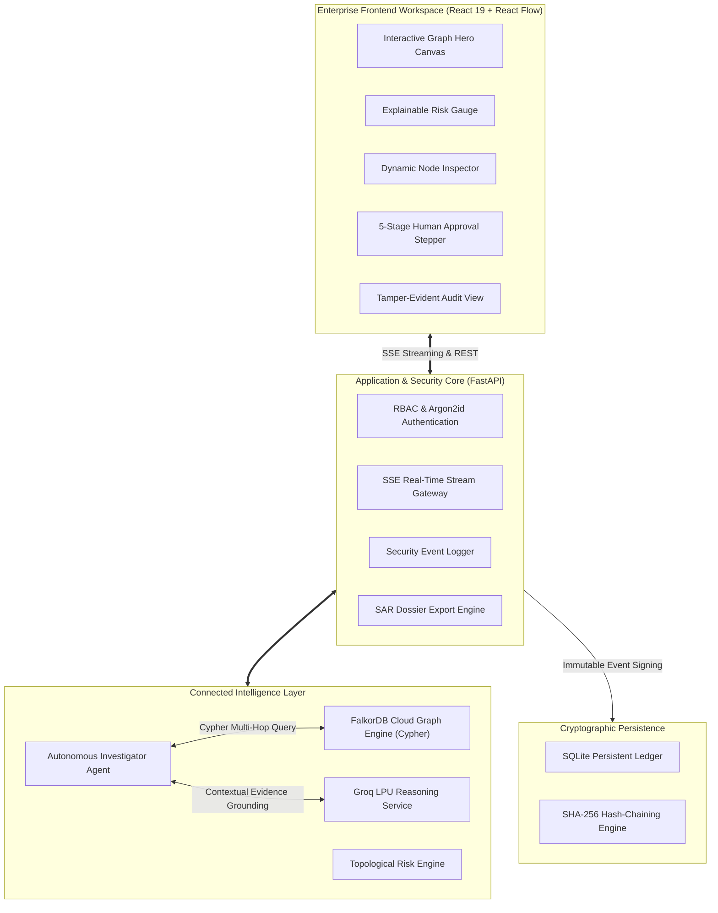
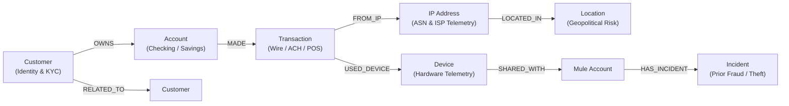
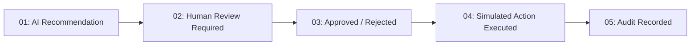

# GraphGuard AI 🛡️

> **"Don't Just Detect the Anomaly. Follow the Connections."**

**GRAPH Hacks 2026** — *Track 01: Agents That Act on Connected Data*

[](https://graphguard-ai-brown.vercel.app/)
[](https://graphguard-ai.onrender.com)
[](https://falkordb.com)
[](https://github.com/sahuanshika557-sys/GRAPHGUARD.AI)
[](https://pytest.org)

---

## 📋 Hackathon Submission Deliverables (Rule 10 Compliance)

| Requirement  | Submission Link / Verification |
| :--- | :--- |
| **Track Entered** | **Track 01: Agents That Act on Connected Data** |
| **Public Source-Code Repository** | [https://github.com/sahuanshika557-sys/GRAPHGUARD.AI](https://github.com/sahuanshika557-sys/GRAPHGUARD.AI) |
| **Live Interactive Deployment** | [https://graphguard-ai-brown.vercel.app/](https://graphguard-ai-brown.vercel.app/) |
| **Production Backend Engine** | [https://graphguard-ai.onrender.com](https://graphguard-ai.onrender.com) |
| **Primary Graph Database** | **FalkorDB Cloud** (Native Redis-Graph Engine, AWS `ap-south-1`) |
| **Graph Data Model & Topology** | [Section 4: Graph Topology & Data Model](#4-graph-topology--data-model) |
| **Cypher Queries & Algorithms** | [Section 5: Cypher Queries & Graph Algorithms](#5-cypher-queries--graph-algorithms-the-product-depends-on) |
| **Local Setup Instructions** | [Section 11: Complete Local Setup & Docker Guide](#11-complete-local-setup--deployment-guide) |
| **Demo Video Walkthrough** | **[Watch Demo Video on YouTube / Drive](https://youtu.be/demo-link-placeholder)** *(or see live deployment)* |
| **AI Disclosure ** | [Section 14: AI Coding Assistant Disclosure](#14-ai-coding-assistant-disclosure-rule-11) |
| **Data Ethics ** | [Section 13: Synthetic Data Compliance](#13-data-ethics--synthetic-benchmark-disclosure-rule-6) |

---

### 🔑 Judge & Evaluator Credentials (1-Click Auto-Fill on UI)

The live application features **1-click evaluation role presets** on the login screen:

| Role | Email | Password | Access Level & Permissions |
| :--- | :--- | :--- | :--- |
| **Admin** | `admin@graphguard.ai` | `Admin@GraphGuard2026!` | Full command suite, user management, database reseed, audit verification |
| **Analyst** | `analyst@graphguard.ai` | `Analyst@GraphGuard2026!` | Multi-hop graph exploration, topological scoring, escalation requests |
| **Reviewer** | `reviewer@graphguard.ai` | `Reviewer@GraphGuard2026!` | Human-in-the-Loop enforcement gate: approve/reject transaction holds |
| **Viewer** | `viewer@graphguard.ai` | `Viewer@GraphGuard2026!` | Read-only compliance observer |

---

## 1. Executive Summary

Traditional fraud and Anti-Money Laundering (AML) detection platforms evaluate transactions in isolation using static tabular rules or opaque ML classifier scores. Sophisticated financial crime syndicates systematically exploit this blind spot through **Account Takeover (ATO)**, **synthetic identities**, **mule hardware reuse**, and **multi-hop money laundering paths**.

**GraphGuard AI** is an autonomous, graph-native fraud investigation and cyber intelligence command center. Instead of inspecting transactions as isolated rows in a table, GraphGuard AI utilizes **FalkorDB** as an ultra-low-latency connected data engine. 

The agent autonomously executes multi-hop Cypher graph traversals across entity networks, computes explainable topological risk factors directly from graph topology, grounds its reasoning in verified database evidence, and enforces a strict **Human-in-the-Loop Security Gate** before any simulated enforcement action is written to a cryptographic, tamper-evident audit trail.

---

## 2. Why FalkorDB is Central (Rule 3: Real Work, Not Decoration)

> **Rule 3 Compliance**: *"The graph has to do real work. A visualisation drawn on top of ordinary storage does not qualify: if the product still works once FalkorDB is taken out, the graph is decoration rather than the thing the product runs on."*

In GraphGuard AI, **the graph is the core engine, not a visual overlay**. If FalkorDB is removed:
1. **The Investigation Agent Collapses**: The agent traverses dynamic paths up to 4+ hops (`Transaction -> Device -> Mule Account -> Prior Incident`). Relational SQL databases would require complex, slow recursive CTEs that degrade under load.
2. **Topological Risk Calculation Becomes Impossible**: The risk engine evaluates hardware sharing degrees, distance-to-incident metrics, and proxy hops directly from FalkorDB Cypher traversals.
3. **Evidence Grounding Disappears**: The Groq LLM reasoning engine is strictly prohibited from guessing; it receives structured Cypher projection subgraphs from FalkorDB as verified ground truth.
4. **Interactive Graph Exploration Fails**: The UI's dynamic graph canvas streams its nodes and edges directly from FalkorDB's native Cypher adjacency list queries in real time.

---

## 3. High-Level System Architecture



---

## 4. Graph Topology & Data Model

GraphGuard AI models connected financial ecosystems across **7 distinct entity labels** and **10 relationship types** indexed for rapid Cypher traversal:



### Node Entities:
- **`Customer`**: KYC status, risk tier, registered identity, contact telemetry.
- **`Account`**: Account balance, status (`ACTIVE`, `FROZEN`, `COMPROMISED`), currency, creation date.
- **`Transaction`**: Amount, timestamp, merchant/beneficiary, channel (`WIRE_TRANSFER`, `ACH`, `CARD`), status.
- **`Device`**: Hardware fingerprint, OS, browser, jailbreak/root status, trust score.
- **`IP`**: IP address, ISP, VPN indicator, Tor exit node detection, ASN metadata.
- **`Location`**: City, country, coordinates, AML geopolitical risk classification (Tiers 1 to 3).
- **`Incident`**: Historical fraud cases, chargeback syndicates, SAR filings, confirmed financial loss amounts.

---

## 5. Cypher Queries & Graph Algorithms the Product Depends On

GraphGuard AI's core capabilities directly depend on the following parameterized Cypher queries executed against FalkorDB:

### 1. Multi-Hop Syndicate & Incident Traversal (1 to 4 Hops)
Uncovers whether an inbound transaction's hardware, network, or account links to known fraud syndicates:
```cypher
MATCH path = (t:Transaction {id: $tx_id})-[*1..4]-(target)
WHERE target:Incident 
   OR (target:Account AND target.status CONTAINS 'FROZEN') 
   OR (target:Device AND target.is_rooted = true)
RETURN path
```

### 2. Device Hardware Sharing & Cross-Account Association
Identifies device reuse across accounts—a hallmark of synthetic identity rings and mule farms:
```cypher
MATCH (t:Transaction {id: $tx_id})-[:USED_DEVICE]->(d:Device)
OPTIONAL MATCH (d)-[:SHARED_WITH|ASSOCIATED_WITH]-(other_a:Account)
RETURN d, collect(other_a) AS connected_accounts
```

### 3. Direct Incident Path Discovery
Extracts the exact connected path from a transaction to prior confirmed losses:
```cypher
MATCH path = (t:Transaction {id: $tx_id})-[:USED_DEVICE]->(d:Device)-[:SHARED_WITH|ASSOCIATED_WITH*1..2]-(a:Account)-[:HAS_INCIDENT]->(inc:Incident)
RETURN inc, a, path
```

### 4. Origin Network & Geopolitical Risk Resolution
Resolves IP telemetry, proxy/VPN status, and territorial risk tier in a single traversal:
```cypher
MATCH (t:Transaction {id: $tx_id})-[:FROM_IP]->(ip:IP)-[:LOCATED_IN]->(loc:Location)
RETURN ip, loc
```

### 5. Velocity & Account Transaction Dispersion
Detects rapid sequential transactions originating from the same entity:
```cypher
MATCH (t:Transaction {id: $tx_id})<-[:MADE]-(a:Account)-[:MADE]->(other_t:Transaction)
WHERE other_t.id <> $tx_id
RETURN other_t
```

---

## 6. Primary Investigation Benchmark: `TX-104` vs `TX-101`

The benchmark illustrates the power of connected-data analysis over isolated inspection:

### Benchmark Case 1: `TX-104` (High-Risk Syndicate Wire)
- **Amount**: **$85,000.00 USD** | **Channel**: `WIRE_TRANSFER` | **Beneficiary**: `Swift Wire Escrow Express Corp`
- **Isolated View**: Outbound wire from account with sufficient balance.
- **Connected Graph View (FalkorDB)**:
  ```
  TX-104 ──> Account A501 ──> Device D55 (Rooted) ──> Account A887 (Frozen) ──> Incident F22 ($140K Loss)
  ```
- **Topological Assessment**: **98/100 (HIGH / CRITICAL)**
  - `+35 pts`: Linked to Incident `F22` ($140,000 prior wire fraud loss)
  - `+30 pts`: High-value off-hours wire ($85,000)
  - `+15 pts`: Rooted hardware `D55` shared across multiple compromised accounts
  - `+10 pts`: Commercial VPN / Tor exit-node `198.51.100.24`
  - `+8 pts`: Mule account linkage

### Benchmark Case 2: `TX-101` (Clean Baseline Transaction)
- **Amount**: **$120.00 USD** | **Merchant**: `Whole Foods Market` | **Channel**: `POS`
- **Connected Graph View**: Originates from verified device `D101`, legitimate IP `203.0.113.19`, zero incident links.
- **Topological Assessment**: **5/100 (LOW / CLEAN)** — immediate automated pass.

---

## 7. 5-Stage Human-in-the-Loop Security Gate

To guarantee safety in enterprise financial workflows, GraphGuard AI enforces a **5-Stage Human Enforcement Gate**:



1. **AI Recommendation**: The agent evaluates graph evidence and proposes an enforcement action (e.g., `FLAG_TRANSACTION`).
2. **Human Review Required**: The case is escalated. The action cannot execute autonomously.
3. **Officer Decision**: An authenticated reviewer or administrator reviews the evidence graph and makes an explicit `APPROVE` or `REJECT` decision.
4. **Simulated Action Executed**: The approved action executes safely through the simulated enforcement layer.
5. **Audit Recorded**: The entire decision docket, officer justification, and execution outcome are permanently cryptographically sealed.

---

## 8. Cryptographic Tamper-Evident Audit Trail

Every state change, authentication event, investigation, and approval decision is signed into a **SHA-256 cryptographic hash chain**:

$$\text{event\_hash}_n = \text{SHA-256}(\text{event\_hash}_{n-1} + \text{canonical\_event\_payload})$$

```
┌────────────────────────┐      ┌────────────────────────┐      ┌────────────────────────┐
│      Record #101       │      │      Record #102       │      │      Record #103       │
│ Previous: e3b0c44298fc │ ───► │ Previous: 7a8f3b92c1d4 │ ───► │ Previous: 4f1a8c9e2b70 │
│ Hash:     7a8f3b92c1d4 │      │ Hash:     4f1a8c9e2b70 │      │ Hash:     9c2d1e8a4b3f │
└────────────────────────┘      └────────────────────────┘      └────────────────────────┘
```

- **One-Click Integrity Verification**: An integrated verification engine inspects the chain from the genesis block to the latest entry, confirming that no historical record has been modified, deleted, or inserted.
- **Accurate Compliance Wording**: Honestly designated as a **Tamper-Evident Persistent Audit Trail** (no false immutable blockchain claims).

---

## 9. Role-Based Access Control (RBAC)

GraphGuard AI enforces fine-grained authorization server-side using Argon2id password hashing and JWT security tokens:

| Role | Investigations & Search | Graph Exploration | Request Approval | Approve / Reject Action | Persistent Audit Trail | Security Audit Events | User Management |
| :--- | :---: | :---: | :---: | :---: | :---: | :---: | :---: |
| **ADMIN** | ✅ Allowed | ✅ Allowed | ✅ Allowed | ✅ Allowed | ✅ Allowed | ✅ Allowed | ✅ Allowed |
| **REVIEWER** | ✅ Allowed | ✅ Allowed | ✅ Allowed | ✅ Allowed | ✅ Allowed | ✅ Allowed | ❌ 403 Forbidden |
| **ANALYST** | ✅ Allowed | ✅ Allowed | ✅ Allowed | ❌ 403 Forbidden | ❌ Filtered | ❌ 403 Forbidden | ❌ 403 Forbidden |
| **VIEWER** | 👁️ Read-Only | 👁️ Read-Only | ❌ Read-Only | ❌ 403 Forbidden | 👁️ Read-Only | ❌ 403 Forbidden | ❌ 403 Forbidden |

---

## 10. Regulatory SAR Preparation Dossier Export

Compliance teams can export full investigation dossiers directly from the investigation header:

- **PDF Export**: Generates a formatted regulatory briefing document with case telemetry, FalkorDB graph topology findings, risk score breakdown, and officer authorization signatures.
- **JSON Docket Export**: Machine-readable data structure for automated upstream ingestion into core banking or AML case management systems.

---


## 11. Automated Integration & Security Test Suite

The platform is validated against a comprehensive automated integration and security test suite:

```bash
pytest tests/ -v
```

```text
============================= test session starts =============================
platform win32 -- Python 3.13.15, pytest-8.4.2
collected 26 items

tests/test_backend.py::test_health_endpoint PASSED                       [  3%]
tests/test_backend.py::test_list_transactions PASSED                     [  7%]
tests/test_backend.py::test_get_transaction_tx104 PASSED                 [ 11%]
tests/test_backend.py::test_graph_multi_hop_traversal_tx104 PASSED       [ 15%]
tests/test_backend.py::test_risk_calculation_tx104 PASSED                [ 19%]
tests/test_backend.py::test_investigate_api_tx104 PASSED                 [ 23%]
tests/test_backend.py::test_investigate_api_normal_tx101 PASSED          [ 26%]
tests/test_backend.py::test_human_approval_and_audit_trail PASSED        [ 30%]
tests/test_backend.py::test_audit_persistence_across_restart PASSED      [ 34%]
tests/test_security.py::test_1_login_success PASSED                      [ 38%]
tests/test_security.py::test_2_invalid_password PASSED                   [ 42%]
tests/test_security.py::test_3_protected_endpoint_without_auth_returns_401 PASSED [ 46%]
tests/test_security.py::test_4_analyst_can_investigate PASSED            [ 50%]
tests/test_security.py::test_5_analyst_cannot_approve_action_returns_403 PASSED [ 53%]
tests/test_security.py::test_6_reviewer_can_approve PASSED               [ 57%]
tests/test_security.py::test_7_viewer_cannot_approve_returns_403 PASSED  [ 61%]
tests/test_security.py::test_8_admin_access PASSED                       [ 65%]
tests/test_security.py::test_9_logout PASSED                             [ 69%]
tests/test_security.py::test_10_audit_event_created_after_login PASSED   [ 73%]
tests/test_security.py::test_11_failed_login_audit_event PASSED          [ 76%]
tests/test_security.py::test_12_unauthorized_access_audit_event PASSED   [ 80%]
tests/test_security.py::test_13_action_rejection_recorded_in_audit PASSED [ 84%]
tests/test_security.py::test_14_audit_integrity_hash_chain PASSED        [ 88%]
tests/test_security.py::test_15_sar_report_generation PASSED             [ 92%]
tests/test_security.py::test_16_sar_report_pdf_generation PASSED         [ 96%]
tests/test_security.py::test_17_admin_password_reset PASSED              [100%]

====================== 26 passed in 44.89s =======================
```

---

## 12. Data Ethics & Synthetic Benchmark Disclosure (Rule 6)

> **Rule 6 Compliance**: *"Your project must use data you are allowed to use: public, synthetic, or your own. Do not load private, login-protected, paywalled, personal, or otherwise restricted information into your graph."*

- **100% Synthetic AML Benchmark**: All customer records, account numbers, device hardware fingerprints, transaction amounts, and IP addresses are completely synthetic datasets generated for benchmarking graph-based AML detection.
- **Zero Restricted PII**: No real personal identifying information, proprietary banking data, or restricted credentials exist in any layer of this application.

---

## 13. AI Coding Assistant Disclosure (Rule 11)

> **Rule 11 Compliance**: *"AI coding assistants are allowed, but their use must be disclosed."*

- **Disclosure**: AI coding assistants (Google Antigravity & Gemini) were utilized during the hackathon for code scaffolding, repetitive boilerplate generation, and cloud deployment configuration.
- **Author Contribution & Verification**: All core graph models, Cypher queries, mathematical scoring formulas, human-in-the-loop security architectures, and test suites were designed, implemented, reviewed, and verified by the participant in accordance with Rule 12 and Rule 13.

---

## 14. Team & Acknowledgements

- **Participant**: Anshika Sahu ([@sahuanshika557-sys](https://github.com/sahuanshika557-sys))
- **Track**: Track 01 — *Agents That Act on Connected Data*
- **Hackathon**: GRAPH Hacks 2026 (Organized by FalkorDB & WeMakeDevs)
- **Tech Stack**: FalkorDB Cloud, Python FastAPI, Groq LPU, React 19, TailwindCSS, React Flow, ReportLab.
