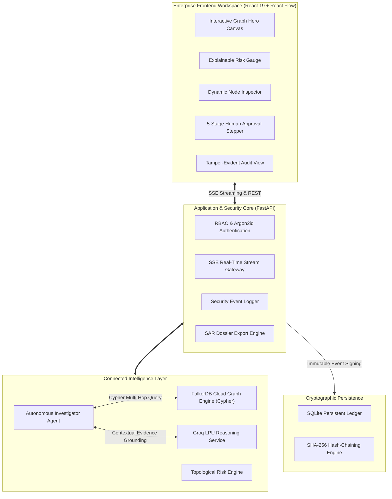
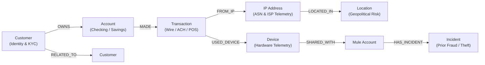
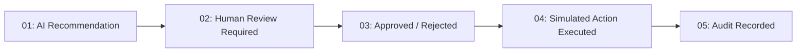

# GraphGuard AI 🛡️

> **"Don't Just Detect the Anomaly. Follow the Connections."**

**GRAPH Hacks 2026** — *Track 01: Agents That Act on Connected Data*

[](https://python.org)
[](https://fastapi.tiangolo.com)
[](https://falkordb.com)
[-F55036?logo=speedtest&logoColor=white)](https://groq.com)
[](https://react.dev)
[](https://reactflow.dev)
[](https://tailwindcss.com)
[](https://pytest.org)
[](https://csrc.nist.gov)

---

## 1. Executive Summary

Traditional fraud and Anti-Money Laundering (AML) detection platforms evaluate transactions in isolation using static tabular rules or machine-learning scores. Sophisticated financial crime syndicates systematically exploit this blind spot through **Account Takeover (ATO)**, **synthetic identities**, **mule hardware reuse**, and **multi-hop money laundering paths**.

**GraphGuard AI** is an autonomous, graph-native fraud investigation and cyber intelligence command center. Instead of inspecting transactions as isolated rows in a table, GraphGuard AI utilizes **FalkorDB Cloud** as an ultra-low-latency connected data engine. 

The agent autonomously executes multi-hop Cypher graph traversals across entity networks, computes explainable topological risk factors directly from graph topology, grounds its reasoning in verified database evidence, and enforces a strict **Human-in-the-Loop Security Gate** before any simulated enforcement action is written to a cryptographic, tamper-evident audit trail.

---

## 2. Core Capabilities & Key Differentiators

```
┌─────────────────────────────────────────────────────────────────────────────┐
│                            GRAPHGUARD AI PLATFORM                           │
├──────────────────────┬───────────────────────────────┬──────────────────────┤
│  CONNECTED DATA      │  EXPLAINABLE AI REASONING     │  ENTERPRISE GOVERNANCE│
│  - FalkorDB Cloud    │  - Grounded Groq LPU LLM     │  - 5-Stage Human Gate│
│  - Multi-Hop Cypher  │  - Factor Breakdown Scoring  │  - SHA-256 Hash Chain│
│  - 7 Entity Models   │  - Strict Evidence Isolation  │  - SAR PDF Export    │
│  - Sub-ms Traversal  │  - Model Confidence Metrics   │  - Role-Based Access │
└──────────────────────┴───────────────────────────────┴──────────────────────┘
```

- **Connected-Risk Discovery (FalkorDB)**: Uncovers multi-hop syndicates (up to 4+ hops) linking seemingly legitimate transactions to rooted devices, shared accounts, and historical fraud incidents in milliseconds.
- **Explainable Topological Scoring**: Discards ungrounded AI guesses. Generates a mathematically verifiable risk score (0–100) where explicit factor weights sum exactly to the final assessment.
- **Grounded AI Intelligence**: Clear architectural boundary separating *Verified FalkorDB Graph Evidence (Ground Truth)* from *AI Interpretation & Reasoning*. The LLM only receives verified graph facts.
- **5-Stage Human-in-the-Loop Gate**: Autonomous agents recommend, but never independently execute high-impact decisions. Every enforcement step requires human officer authorization.
- **Cryptographic Tamper-Evident Audit Trail**: Every investigation step, login, approval, and rejection is recorded in a persistent hash-chained audit ledger with 1-click cryptographic integrity verification.
- **SAR Preparation & Investigation Export**: One-click generation of formatted, compliance-ready **Investigation & SAR Preparation Dossiers** in both PDF and structured JSON formats.

---

## 3. High-Level System Architecture



---

## 4. Graph Topology & Data Model

GraphGuard AI models connected financial ecosystems across **7 distinct entity labels** and **10 relationship types** indexed for rapid Cypher traversal:



### Node Entities:
- **`Customer`**: KYC status, risk tier, registered identity, contact telemetry.
- **`Account`**: Account balance, status (`ACTIVE`, `FROZEN`, `COMPROMISED`), currency, creation date.
- **`Transaction`**: Amount, timestamp, merchant/beneficiary, channel (`WIRE_TRANSFER`, `ACH`, `CARD`), status.
- **`Device`**: Hardware fingerprint, OS, browser, jailbreak/root status, trust score.
- **`IP`**: IP address, ISP, VPN indicator, Tor exit node detection, ASN metadata.
- **`Location`**: City, country, coordinates, AML geopolitical risk classification (Tiers 1 to 3).
- **`Incident`**: Historical fraud cases, chargeback syndicates, SAR filings, confirmed financial loss amounts.

---

## 5. Primary Investigation Case Study: `TX-104`

The primary benchmark demonstrates how GraphGuard AI uncovers an evasive multi-hop wire fraud cash-out:

### Telemetry:
- **Transaction**: `TX-104`
- **Amount**: **$85,000.00 USD**
- **Channel**: `WIRE_TRANSFER`
- **Beneficiary**: `Swift Wire Escrow Express Corp`
- **Origin Account**: `A501` (Customer Marcus Vance)

### Autonomous Multi-Hop Discovery Path:
```
TX-104 ──> Account A501 ──> Device D55 ──> Account A887 ──> Incident F22
```

1. **Step 1 (Transaction Lookup)**: `TX-104` is initiated from checking account `A501`.
2. **Step 2 (Device Telemetry)**: Hardware inspection reveals Device `D55` (MacBook running Headless Chrome, `is_rooted=True`).
3. **Step 3 (Hardware Cross-Pollination)**: FalkorDB traverses `[:SHARED_WITH]` relationships and uncovers that Device `D55` was also used by Account `A887` (`FROZEN_COMPROMISED`).
4. **Step 4 (Incident Linkage)**: Multi-hop graph traversal detects that Account `A887` is directly linked to **Incident F22** (*"Account Takeover wire fraud cash-out, $140,000 confirmed loss"*).
5. **Step 5 (Network Telemetry)**: Network analysis reveals originating IP `198.51.100.24` is a confirmed Tor exit node and commercial VPN located in a Tier 3 high-risk geopolitical jurisdiction.

### Mathematical Risk Score Breakdown:
The composite risk score is evaluated dynamically from verified graph features:

$$\text{Risk Score} = \sum \text{Factor Contributions} = 35 + 30 + 15 + 10 + 8 = \mathbf{98/100} \quad (\text{HIGH / CRITICAL})$$

| Factor Name | Contribution | Verified Graph Evidence |
| :--- | :---: | :--- |
| **Connected Fraud Incident** | `+35 pts` | Direct syndicate path to Incident `F22` ($140,000 prior loss) |
| **High-Value Rapid Wire** | `+30 pts` | $85,000 off-hours outbound wire transfer |
| **Rooted Hardware / Shared Device** | `+15 pts` | Jailbroken hardware `D55` shared across multiple accounts |
| **Network Anomaly / Tor/VPN** | `+10 pts` | Originating from commercial VPN / Tor exit-node `198.51.100.24` |
| **Account Velocity & Mule Links** | `+8 pts` | Multi-hop links to known high-velocity mule accounts |

---

## 6. Human-in-the-Loop Security Gate

To guarantee safety in enterprise financial workflows, GraphGuard AI enforces a **5-Stage Human Enforcement Gate**:



1. **AI Recommendation**: The agent evaluates graph evidence and proposes an enforcement action (e.g., `FLAG_TRANSACTION`).
2. **Human Review Required**: The case is escalated. The action cannot execute autonomously.
3. **Officer Decision**: An authenticated reviewer or administrator reviews the evidence graph and makes an explicit `APPROVE` or `REJECT` decision.
4. **Simulated Action Executed**: The approved action executes safely through the simulated enforcement layer.
5. **Audit Recorded**: The entire decision docket, officer justification, and execution outcome are permanently cryptographically sealed.

---

## 7. Cryptographic Tamper-Evident Audit Trail

Every state change, authentication event, investigation, and approval decision is signed into a **SHA-256 cryptographic hash chain**:

$$\text{event\_hash}_n = \text{SHA-256}(\text{event\_hash}_{n-1} + \text{canonical\_event\_payload})$$

```
┌────────────────────────┐      ┌────────────────────────┐      ┌────────────────────────┐
│      Record #101       │      │      Record #102       │      │      Record #103       │
│ Previous: e3b0c44298fc │ ───► │ Previous: 7a8f3b92c1d4 │ ───► │ Previous: 4f1a8c9e2b70 │
│ Hash:     7a8f3b92c1d4 │      │ Hash:     4f1a8c9e2b70 │      │ Hash:     9c2d1e8a4b3f │
└────────────────────────┘      └────────────────────────┘      └────────────────────────┘
```

- **One-Click Integrity Verification**: An integrated verification engine inspects the chain from the genesis block to the latest entry, confirming that no historical record has been modified, deleted, or inserted.
- **Accurate Compliance Wording**: Honestly designated as a **Tamper-Evident Persistent Audit Trail** (no false immutable blockchain claims).

---

## 8. Role-Based Access Control (RBAC)

GraphGuard AI enforces fine-grained authorization server-side using Argon2id password hashing and JWT security tokens:

| Role | Investigations & Search | Graph Exploration | Request Approval | Approve / Reject Action | Persistent Audit Trail | Security Audit Events | User Management |
| :--- | :---: | :---: | :---: | :---: | :---: | :---: | :---: |
| **ADMIN** | ✅ Allowed | ✅ Allowed | ✅ Allowed | ✅ Allowed | ✅ Allowed | ✅ Allowed | ✅ Allowed |
| **REVIEWER** | ✅ Allowed | ✅ Allowed | ✅ Allowed | ✅ Allowed | ✅ Allowed | ✅ Allowed | ❌ 403 Forbidden |
| **ANALYST** | ✅ Allowed | ✅ Allowed | ✅ Allowed | ❌ 403 Forbidden | ❌ Filtered | ❌ 403 Forbidden | ❌ 403 Forbidden |
| **VIEWER** | 👁️ Read-Only | 👁️ Read-Only | ❌ Read-Only | ❌ 403 Forbidden | 👁️ Read-Only | ❌ 403 Forbidden | ❌ 403 Forbidden |

---

## 9. Suspicious Activity Report (SAR) Dossier Export

Compliance teams can export full investigation dossiers directly from the investigation header:

- **PDF Export**: Generates a formatted, multi-page regulatory briefing document including:
  - Official case header and timestamp
  - Transaction profile and execution telemetry
  - Connected data and FalkorDB graph evidence summary
  - Explainable risk factor score breakdown table
  - Human-in-the-Loop authorization audit record and cryptographic hash
- **JSON Docket Export**: Complete machine-readable data structure for automated upstream ingestion into core banking or AML case management systems.

*Disclaimer: GraphGuard AI is designed to support fraud, AML, and SAR preparation investigation workflows. Exported dossiers support regulatory SAR preparation and do not claim to replace statutory filing portals.*

---

## 10. Automated Test Suite & Quality Verification

The platform is validated against a comprehensive automated integration and security test suite:

```text
============================= test session starts =============================
platform win32 -- Python 3.13.15, pytest-8.4.2
collected 26 items

tests/test_backend.py::test_health_endpoint PASSED                       [  3%]
tests/test_backend.py::test_list_transactions PASSED                     [  7%]
tests/test_backend.py::test_get_transaction_tx104 PASSED                 [ 11%]
tests/test_backend.py::test_graph_multi_hop_traversal_tx104 PASSED       [ 15%]
tests/test_backend.py::test_risk_calculation_tx104 PASSED                [ 19%]
tests/test_backend.py::test_investigate_api_tx104 PASSED                 [ 23%]
tests/test_backend.py::test_investigate_api_normal_tx101 PASSED          [ 26%]
tests/test_backend.py::test_human_approval_and_audit_trail PASSED        [ 30%]
tests/test_backend.py::test_audit_persistence_across_restart PASSED      [ 34%]
tests/test_security.py::test_1_login_success PASSED                      [ 38%]
tests/test_security.py::test_2_invalid_password PASSED                   [ 42%]
tests/test_security.py::test_3_protected_endpoint_without_auth_returns_401 PASSED [ 46%]
tests/test_security.py::test_4_analyst_can_investigate PASSED            [ 50%]
tests/test_security.py::test_5_analyst_cannot_approve_action_returns_403 PASSED [ 53%]
tests/test_security.py::test_6_reviewer_can_approve PASSED               [ 57%]
tests/test_security.py::test_7_viewer_cannot_approve_returns_403 PASSED  [ 61%]
tests/test_security.py::test_8_admin_access PASSED                       [ 65%]
tests/test_security.py::test_9_logout PASSED                             [ 69%]
tests/test_security.py::test_10_audit_event_created_after_login PASSED   [ 73%]
tests/test_security.py::test_11_failed_login_audit_event PASSED          [ 76%]
tests/test_security.py::test_12_unauthorized_access_audit_event PASSED   [ 80%]
tests/test_security.py::test_13_action_rejection_recorded_in_audit PASSED [ 84%]
tests/test_security.py::test_14_audit_integrity_hash_chain PASSED        [ 88%]
tests/test_security.py::test_15_sar_report_generation PASSED             [ 92%]
tests/test_security.py::test_16_sar_report_pdf_generation PASSED         [ 96%]
tests/test_security.py::test_17_admin_password_reset PASSED              [100%]

====================== 26 passed in 44.89s =======================
```

---

## 11. Security & Production Hardening

- **Zero Secret Exposure**: The frontend production bundle is completely scrubbed of API keys, database credentials, and authentication secrets.
- **Argon2id Password Storage**: User passwords are encrypted with memory-hard Argon2id hashing algorithms.
- **Server-Side Authorization**: API routes actively enforce role permissions independently of UI visibility.
- **Strict Rate-Limiting & Generic Errors**: Authentication failures return generic messages (`Invalid email or password.`) to prevent account enumeration.

---

## 12. License & Acknowledgements

Developed for **GRAPH Hacks 2026** (Track 01: *Agents That Act on Connected Data*).  
Built with **FalkorDB**, **FastAPI**, **Groq AI**, **React 19**, and **React Flow**.
